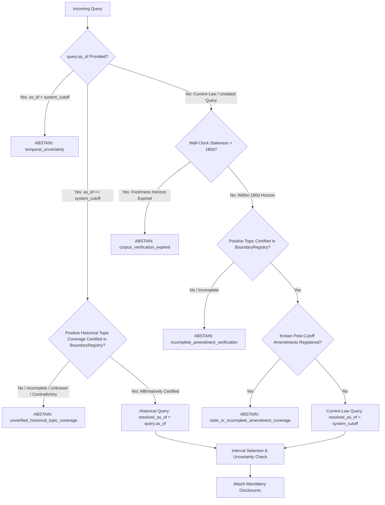

# Retrieval, Multi-Version Indexing & Verification Contracts

*Repo-grounded against `src/uae_lexagent/retrieval/contracts.py`, `src/uae_lexagent/retrieval/indexing.py`, `src/uae_lexagent/synthesis/contracts.py`, and `src/uae_lexagent/synthesis/verifier.py`.*

---

## 1. Fail-Closed `RetrievalFilters` Contract (`retrieval/contracts.py`)

```python
class RetrievalFilters(BaseModel):
    model_config = ConfigDict(extra="forbid", frozen=True)

    jurisdiction: Jurisdiction = Jurisdiction.UNKNOWN
    as_of: date | None = None
    language: Language = Language.UNKNOWN
    include_translations: bool = True
    authoritative_only: bool = False
    document_ids: tuple[str, ...] = ()
    legal_domain: str | None = None

    # Phase 5.2 fail-closed eligibility controls
    include_caveated: bool = False
    accepted_caveat_codes: tuple[str, ...] = ()
    allow_legacy_unverified: bool = False
    allow_stale_corpus: bool = False
```

### Eligibility Filter Rules (`matches_retrieval_filters`)
1. `BLOCKED_LEGAL_TOPIC` and `UNRESOLVED_HISTORICAL` ALWAYS return `False`.
2. `LEGACY_UNVERIFIED` returns `False` unless `filters.allow_legacy_unverified is True` (strictly confined to compatibility-test fixtures; prohibited in production).
3. `PUBLISHED_WITH_CAVEAT` returns `False` unless `filters.include_caveated is True` **AND** (either `filters.accepted_caveat_codes` is empty with downstream disclosure enforcement enabled, OR `set(provision.caveat_codes).issubset(set(filters.accepted_caveat_codes))`).
4. `VERIFIED_PUBLISHABLE` is eligible subject to jurisdiction, language, document, domain, and `as_of` filters.

---

## 2. Multi-Version `RetrievalIndex` Contract (`retrieval/indexing.py`)

### Index Maps
- `provisions_by_id: dict[str, LegalProvision]` — unique `provision_id`.
- `version_map: dict[str, dict[str, LegalProvision]]` — keyed by `version_id -> {lang: LegalProvision}`. Duplicate `(version_id, language)` raises `ValueError`.
- `versions_by_logical_id: dict[str, list[str]]` — maps `logical_provision_id -> list[version_id]` sorted by `effective_from`.
- `alignment_map: dict[str, dict[str, LegalProvision]]` — backward-compatible map populated with the single active (`IN_FORCE`) version per `alignment_id` (or the sole version in single-version legacy corpora).
- `quarantine_registry: dict[str, list[LegalProvision]]` — non-indexed metadata store for `UNRESOLVED_HISTORICAL` and `BLOCKED_LEGAL_TOPIC` provisions (never inserted into `vector_store` or `sparse_index`), used strictly to emit accurate abstention reasons.

### Same-Version Bilingual Alignment Invariant
- For any entry in `version_map[version_id]`: the Arabic provision (`ar_provision_id`) and English provision (`en_provision_id`) **MUST share the exact same `version_id`**.
- Cross-version alignment (e.g., pairing a 2024 Arabic amendment with a 2021 English provision) is strictly prohibited and rejected by `RV-09`.

### Candidate Version Pruning Before Rank Fusion
- In hybrid retrieval (dense + sparse BM25), multi-version candidate expansion occurs prior to scoring.
- For a given `as_of`, only the single active version per `logical_provision_id` is admitted into the candidate scoring pool. Inactive or superseded versions are pruned before reciprocal rank fusion to prevent score dilution or conflicting version citations in top-$k$ results.

---

## 3. Fail-Closed Current-Law & Temporal Safety Contract

To ensure that a historical corpus verification cutoff is **never silently presented as current law**, LexAgent enforces strict temporal disambiguation, positive coverage certification, freshness clocks, and multi-stage fail-closed gates.

### 3.1 Closed-World Assumption & Positive Coverage Requirement
- **Anti-Open-World Principle:** The absence of a registered subsequent amendment in `BoundaryRegistry` **must never be treated as evidence of complete statutory coverage**.
- An undated / current-law query may only be served if the queried topic/article is **positively certified** as having complete amendment coverage through the system verification cutoff date in `BoundaryRegistry.verified_topics`.
- **Incomplete / Unknown Registry Behavior:** If `BoundaryRegistry.coverage_status` is `UNKNOWN`, `INCOMPLETE`, or if the requested topic is not positively registered in `verified_topics`, the engine **MUST FAIL CLOSED** with `abstention_reason="incomplete_amendment_verification"`.

### 3.2 Precedence of Temporal & Freshness Checks

When evaluating a query, the system evaluates safety gates in the following strict order:



1. **Gate 1: Query Intent & Explicit Historical vs. Current-Law Resolution:**
   - **Explicit Historical Date (`query.as_of is not None`):**
     - If `query.as_of > system_cutoff`: **Fail closed immediately** with `abstention_reason="temporal_uncertainty"` (the system refuses to extrapolate future law).
     - If `query.as_of <= system_cutoff`:
       - **Gate 1B (Affirmative Historical Coverage Certification):** The queried statutory topic/article MUST be affirmatively certified in `BoundaryRegistry.verified_topics` as having complete, verified historical coverage spanning `query.as_of`.
       - *Strict Coverage Invariant:* Matching an existing historical provision version in the corpus is **strictly insufficient by itself**. If historical coverage for that topic at `query.as_of` is uncertified, missing, marked `UNKNOWN`, `INCOMPLETE`, or contradictory, the system **MUST FAIL CLOSED AND ABSTAIN** with `abstention_reason="unverified_historical_topic_coverage"`.
       - Only when positive historical coverage is certified does `resolved_as_of = query.as_of`. The answer is governed by historical status; system attaches `HISTORICAL_ANSWER_CAVEAT` and `TEMPORAL_CUTOFF_DISCLOSURE`. Explicit historical queries are exempt from the 180-day wall-clock execution limit, but remain strictly contingent upon verified historical topic coverage.
   - **Current-Law / Undated Query (`query.as_of is None`):**
     - The query seeks the current state of UAE employment law.
     - Must pass Gates 2, 3, and 4 before any substantive answer may be generated.

2. **Gate 2: 180-Day Freshness Horizon Clock (Execution Guardrail for Current Law):**
   - Let `system_cutoff = index.effective_as_of_max` (`2024-08-31`).
   - If `execution_date - system_cutoff > 180 days`:
     - The knowledge horizon of the corpus is stale relative to real-world time.
     - **Mandatory Invariant:** A warning alone **MUST NEVER** authorize a current-law answer. If the 180-day freshness horizon is expired, current-law queries **MUST FAIL CLOSED AND ABSTAIN** with:
       `abstention_reason="corpus_verification_expired"`.
     - *No bypass permitted:* Emitting substantive legal advice about "current law" when the knowledge horizon has expired violates legal safety, as subsequent unindexed amendments may have altered or repealed statutory obligations.

3. **Gate 3: Positive Topic Coverage & BoundaryRegistry Check (Current Law):**
   - The query's target topic/article must be positively listed in `BoundaryRegistry.verified_topics`.
   - If the topic is unlisted, marked `UNKNOWN`, or if `BoundaryRegistry.coverage_status != COMPLETE`, the system **MUST FAIL CLOSED AND ABSTAIN** with:
     `abstention_reason="incomplete_amendment_verification"`.

4. **Gate 4: Post-Cutoff Amendment Check:**
   - If candidate provisions belong to a topic with known post-cutoff amendments registered in `BoundaryRegistry.post_cutoff_amendments` (e.g. WPS rules under Ministerial Resolution 340/2026), the system **MUST FAIL CLOSED AND ABSTAIN** with:
     `abstention_reason="stale_or_incomplete_amendment_coverage"`.
   - Only when Gates 2, 3, and 4 pass does the current-law query bind to `resolved_as_of = system_cutoff` (`2024-08-31`) with mandatory `TEMPORAL_CUTOFF_DISCLOSURE`.

5. **Step 5: Closed Inclusive Interval Selection on `resolved_as_of`:**
   - For candidate `logical_provision_id`:
     - Check `quarantine_registry`: if an `UNRESOLVED_HISTORICAL` entry has `uncertainty_window_start <= resolved_as_of <= uncertainty_window_end`, abstain with `abstention_reason="temporal_uncertainty"`.
     - Check `quarantine_registry`: if matching version is `BLOCKED_LEGAL_TOPIC`, abstain with `abstention_reason="blocked_legal_topic"`.
     - Select eligible versions where `(effective_from is None or effective_from <= resolved_as_of)` AND `(effective_until is None or resolved_as_of <= effective_until)` AND `lifecycle_state in {IN_FORCE, SUPERSEDED}`.
     - Enforce cardinality: `count == 0` -> excluded; `count == 1` -> selected; `count > 1` -> fail closed with `abstention_reason="ambiguous_temporal_overlap"`.

6. **Step 6: Pending-Case Transitional Handling (FDL 9/2024 Art. 2 Operative Contract):**
   - For dispute procedure queries touching Article 54, the engine MUST execute the following mutually exclusive, strictly ordered decision logic:

     1. **Branch 1 (Coverage Requirement):** Require affirmative Article 54 coverage at the evaluation date under the applicable historical or current-law coverage gate. Use that gate's abstention reason if coverage fails.
     2. **Branch 2 (Evaluation Date & Governing Version Resolution):** Use `resolved_as_of` from the temporal gates. Let `T` be the independently verified commencement of FDL 9/2024. Until `T` is verified, quarantine Article 54 answers within `[2024-08-30, 2024-08-31]` inclusive and abstain with `temporal_uncertainty` whenever the answer depends on unresolved commencement or posture at `T`. Apply this safeguard before selecting the governing version or venue and before ranking evidence. A coverage certificate, disclosure, or the planning cutoff cannot override it. After the safeguard passes, require a unique verified version valid on `resolved_as_of`. See [EVID-17](../M5.2.0_Legal_Source_Verification.md#32-federal-decree-law-no-9-of-2024-procedural-shift-transition--penalties).
     3. **Branch 3 (Pre-Commencement Historical Evaluation):** For an evaluation known to precede commencement, apply the verified version governing `resolved_as_of` and exit before checking any Article 2 facts.
        - For dates before `2024-01-01`, use the verified original Article 54 if in scope and available. The archival text is pending in this baseline, so fail closed with `temporal_uncertainty` if the historical coverage gate has passed but the governing text remains unresolved. Dates outside verified corpus scope also abstain.
        - From `2024-01-01` until superseded, subject to Branch 2, apply the FDL 20/2023 version. For an Article 54(3) challenge, it provides for filing in the Court of Appeal within 15 working days of notice and a judgment within 15 working days of filing. The version also provides for a one-year limitation from when the right fell due.
        - Attach `HISTORICAL_ANSWER_CAVEAT` and `TEMPORAL_CUTOFF_DISCLOSURE` to any substantive historical answer.
     4. **Branch 4 (Substantive Scope Verification):** Check whether the matter arises under Article 54(3) of FDL 33/2021 as amended (a challenge/lawsuit by either party against a final summary decision issued by MoHRE under Article 54(2) for claims <= AED 50,000 or non-compliance with amicable settlements).
     5. **Branch 5 (Matters Outside Article 54(3) Scope):** If the matter falls outside Article 54(3):
        - Article 2 pending-case transfer does **NOT** apply.
        - **Explicit Exclusion of Article 54(4) Unresolved Referrals:** Article 54(4) disputes (unresolved labor complaints referred by MoHRE directly to the competent court for adjudication) are ordinary substantive referrals, NOT challenges to MoHRE summary decisions under Article 54(3); they are strictly excluded from Article 2 transfer scope.
        - The engine **MUST NOT** infer court jurisdiction or transfer from Article 2 for these matters; it must resolve them independently under ordinary procedural law or fail closed/abstain with `abstention_reason="missing_procedural_facts"`.
     6. **Branch 6 (Procedural Posture Evidence Sufficiency at Commencement):** For qualifying Article 54(3) matters evaluated at or after verified `T`, establish Court of Appeal posture at `T`. A transfer requires affirmative evidence of pendency and of the absence of both exceptions. An established exception, dismissal, withdrawal, or new direct challenge can determine non-transfer without irrelevant status facts.
     7. **Branch 7 (Missing or Contradictory Procedural Facts):** If required procedural facts (pendency at commencement, decided status, reserved-for-judgment status, or whether the dispute arises under Art. 54(3) vs Art. 54(4)) are missing, ambiguous, or contradictory:
        - The engine **MUST NEVER** infer transfer or court venue from filing date alone.
        - The engine **MUST FAIL CLOSED AND ABSTAIN** with `abstention_reason="missing_procedural_facts"` or prompt for necessary procedural facts.
     8. **Branch 8 (Decided Case Exception):** If the lawsuit was already decided (*محكوم فيها*) by the Court of Appeal at `T`:
        - The statutory decision exception under Article 2 applies: **no transfer** to the Court of First Instance occurs; the matter remains under the authority of the Court of Appeal judgment.
     9. **Branch 9 (Reserved for Judgment Exception):** If the lawsuit was reserved for judgment (*محجوزة للحكم*) before the Court of Appeal at `T`:
        - The statutory exception under Article 2 applies: **no transfer** occurs; jurisdiction remains with the Court of Appeal to render judgment.
     10. **Branch 10 (Qualifying Pending Lawsuit Transfer):** If the lawsuit arises under Article 54(3), was pending before the Court of Appeal at `T`, was **NOT** decided, and was **NOT** reserved for judgment:
         - Statutory transfer applies: the Court of Appeal transfers the lawsuit *ex officio* (*تحيل محاكم الاستئناف من تلقاء نفسها*) without judicial fees (*ودون رسوم*) to the competent Court of First Instance (*المحكمة الابتدائية المختصة*) in its existing condition (*بالحالة التي تكون عليها*).
         - Attach `PENDING_CASE_TRANSITION_DISCLOSURE`.
     11. **Branch 11 (Otherwise / Default Disposition):** Article 2 transfer does not apply. For a new challenge to an Article 54(2) MoHRE decision governed by the FDL 9/2024 version, amended Article 54(3) provides for direct filing in the competent Court of First Instance within 15 working days of notification or service of the decision. For other non-pending matters, resolve the applicable rule separately or abstain.

   - **Future acceptance:** [S-11 through S-20](../spec.md#2-user--system-scenarios) and REG-TRANSITION-01 through REG-TRANSITION-10 below exercise the terminal outcomes. Cases that assume verified `T` use test-only evidence and a certified cutoff covering the evaluation date.

7. **Step 7: Mandatory Temporal Cutoff Disclosure:**
   - All undated answers MUST attach `TEMPORAL_CUTOFF_DISCLOSURE`:
     `"This answer uses verified UAE federal employment provisions applicable on the stated evaluation date. The corpus evaluation cutoff is 2024-08-31."`
   - `CitationVerifier` enforces that this caveat is rendered in the final output text.

---

## 4. Multi-Stage Enforcement Architecture Across Actual Repository Modules

The following checkpoints define future enforcement in the existing repository modules:

1. **Pre-Retrieval Stage (`src/uae_lexagent/routing.py`, `src/uae_lexagent/agent/router.py`, `src/uae_lexagent/retrieval/contracts.py`):**
   - Validates jurisdiction boundaries, rejects DIFC/ADGM traps, checks the 180-day freshness horizon clock on current-law queries, checks `BoundaryRegistry` positive topic coverage (for current law and historical dates), and flags required procedural facts for Article 54 disputes.
2. **Statutory Tool Execution Stage (`src/uae_lexagent/tools.py`):**
   - Statutory calculation tools (e.g. `calculate_gratuity`, `evaluate_dispute_timeline`) validate `as_of` dates. If an input date exceeds `system_cutoff` or targets an unverified historical topic, tools fail closed with `temporal_uncertainty` rather than computing ungrounded results.
3. **Retrieval & Fusion Execution Stage (`src/uae_lexagent/retrieval/`):**
   - Enforced identically across standalone baseline retrieval (`src/uae_lexagent/retrieval/baseline.py`), vector store implementations (`src/uae_lexagent/retrieval/vector_store.py`: `InMemoryVectorStore.query()`, `QdrantVectorStore.query()`), sparse BM25 search (`src/uae_lexagent/retrieval/sparse.py`), hybrid fusion (`src/uae_lexagent/retrieval/hybrid.py`, `src/uae_lexagent/retrieval/fusion.py`), and multi-version index management (`src/uae_lexagent/retrieval/indexing.py`).
   - Candidate versions are pruned prior to Reciprocal Rank Fusion; same-version bilingual alignment collapsing is enforced.
4. **Synthesis & Verification Stage (`src/uae_lexagent/synthesis/engine.py`, `src/uae_lexagent/synthesis/verifier.py`):**
   - **Existing interfaces:** `LegalSynthesisEngine.synthesize(query)` calls `self.retriever.search(...)` and passes the results to `LegalSynthesisEngine.synthesize_from_evidence(query, evidence)`. Neither synthesis method currently accepts `filters`. The vector stores already expose `query(vector, filters=None, top_k=5)`.
   - **Future universal gate:** Both synthesis paths MUST apply the same provenance, publication-state, and temporal/version checks before passing evidence to a generator. Without explicit eligibility policy, enforce strict defaults (`include_caveated=False`, `allow_legacy_unverified=False`, `authoritative_only=False`). Likewise, omitted or `None` vector-store filters MUST enforce strict defaults before candidate ranking. Scenario 3 specifies future caveat opt-in behavior without prescribing a method signature.
   - `CitationVerifier` MUST authorize claims and their citations against the eligible evidence identities and version-scoped entries in the checksummed `data/official_sources/claim_key_registry.json`. An `alignment_id` alone never establishes eligibility or claim support.
   - Verifies that all required caveat codes (e.g. `STATUTORY_INTERACTION_CR_96_2023`, `TEMPORAL_CUTOFF_DISCLOSURE`, `PENDING_CASE_TRANSITION_DISCLOSURE`, `HISTORICAL_ANSWER_CAVEAT`) are present in `GroundedLegalAnswer.caveat_disclosures` and rendered in `full_text`.
5. **Agent Orchestration & Publication Stage (`src/uae_lexagent/agent/nodes.py`, `src/uae_lexagent/agent/graph.py`, `src/uae_lexagent/agent/orchestrator.py`):**
   - **Existing agent path:** `synthesis_node(state, generator)` calls `generator.generate(...)` directly with state evidence. `verification_node(state, verifier)` verifies the draft and `finalize_node(state)` returns `LegalResponse`.
   - **Future agent enforcement:** Apply the shared gate before the direct generator call. If no eligible evidence can support the answer, abstain before invoking the generator. Both graph implementations must preserve the verification result through finalization.
   - `finalize_node` MUST bind each claim's `evidence_ids` and emitted citations to the verifier-approved evidence for that specific claim and version. Raw `state.retrieved_evidence` and alignment-only lookups cannot supply IDs. Preserve version-scoped citations and planned caveat disclosures from `GroundedLegalAnswer` in `LegalResponse`. If a binding cannot be verified, finalize with `answerable=False` and propagate the applicable abstention reason through `LegalResponse.fallback_reason`.

---

### 4.1 Universal Evidence Invariants & Future Acceptance Scenarios

To ensure universal legal safety across all synthesis entry points, the following four invariants are mandated:
1. **Strict Default Fallbacks:** If `filters` are omitted or `None`, strict defaults apply (`include_caveated=False`, `allow_legacy_unverified=False`, `authoritative_only=False`).
2. **Universal Caller-Evidence Validation:** Caller-supplied evidence passed to `LegalSynthesisEngine.synthesize_from_evidence()` is subjected to the exact same provenance, publication state, and version-scoped checks as retrieved evidence; unverified caller evidence fails closed.
3. **Exclusive Verified Claim Derivation:** Claims and their evidence references in both outputs must be backed by the specific eligible evidence IDs and provision versions authorized for the claim key. Sharing an alignment ID cannot confer eligibility.
4. **Dual-Path Parity:** Version-scoped citations and caveat disclosures must be preserved identically across both `GroundedLegalAnswer` and `LegalResponse`.

#### Future Acceptance Scenarios (Implementation in M5.2.3 / M5.2.4):
- **Scenario 1 (Direct Caller Evidence Fails Closed on Strict Defaults):** Caller invokes `LegalSynthesisEngine.synthesize_from_evidence(query, evidence)` without explicit eligibility policy. Only `LEGACY_UNVERIFIED` or unauthorized `PUBLISHED_WITH_CAVEAT` evidence is supplied. No evidence reaches generation. The answer abstains with `unverified_evidence_provenance` or `unauthorized_caveated_evidence`, respectively.
- **Scenario 2 (Direct Caller Evidence Succeeds with Verified Publishable Evidence):** Caller supplies clean `VERIFIED_PUBLISHABLE` provisions with approved claim keys in `claim_key_registry.json`. Provenance is verified; synthesis succeeds with verified citations.
- **Scenario 3 (Caller Passes Caveated Evidence with Explicit Opt-In):** Under a future policy explicitly authorizing `PUBLISHED_WITH_CAVEAT` evidence, caller-supplied Article 51(2) passes with `STATUTORY_INTERACTION_CR_96_2023` disclosed if provenance and claim checks also pass.
- **Scenario 4 (Retrieval-Driven Entry Point Enforces Candidate Pruning):** Exercise `LegalSynthesisEngine.synthesize(query)` with the hybrid retriever. The retrieval pipeline enforces strict eligibility and prunes candidates to the single active version per `logical_provision_id` before fusion. The engine rechecks returned evidence before generation.
- **Scenario 5 (Agent Claim-to-Evidence Derivation):** In the direct agent path, `verification_node` must bind each verified claim to its approved evidence IDs and provision versions.
- **Scenario 6 (Final Response Packaging Dual-Path Parity):** `src/uae_lexagent/agent/nodes.py` packages `GroundedLegalAnswer` into `LegalResponse`, preserving all version-scoped citations and caveat disclosures (`TEMPORAL_CUTOFF_DISCLOSURE`, `PENDING_CASE_TRANSITION_DISCLOSURE`, etc.) 1:1.
- **Scenario 7 (Fabricated Evidence Rejection):** Caller passes synthetic, unverified, or fabricated provision objects with spoofed IDs to `LegalSynthesisEngine.synthesize_from_evidence()` or `synthesis_node`. The universal gate fails closed as `VerificationStatus.UNVERIFIED` (`abstention_reason="unverified_evidence_provenance"`).
- **Scenarios 8–12 (Required Bypass Regressions):** Run REG-EVIDENCE-08 through REG-EVIDENCE-12 below. Check actual generator inputs, verifier claim bindings, and final response evidence IDs as specified by each case.

---

## 5. Fail-Closed `CitationVerifier` & Claim-Key Registry Contract (`src/uae_lexagent/synthesis/verifier.py`)

### Data-Driven Claim-Key Registry (`data/official_sources/claim_key_registry.json`)
- Replaces hardcoded `_ALIGNMENT_CLAIM_KEYS`.
- Loaded at `CitationVerifier` initialization with SHA-256 verification against `release_manifest.json`.
- Only entries with `review_status == "approved"` are active.
- **Zero Auto-Authorization:** Any `logical_provision_id` / `version_id` without an `approved` registry entry yields an empty allowed `claim_key` set -> every claim citing it fails closed as `VerificationStatus.UNVERIFIED` (`no_authorized_claim_keys`).
- **Version Scoping:** An entry applies only if the retrieved evidence's `version_id` is in `entry.applicable_version_ids`. A new version ID, bound to the verified effective date of its amendment, requires its own claim-key authorization.
- **Article 51 Invariant Binding:** Severance eligibility threshold claims (`gratuity_entitlement_service_threshold`) must bind to **Article 51(2)** (`FDL_33_2021_ART_51_02`), NOT Article 51(1).

---

## 6. Deterministic Regression Test Specifications

The following deterministic regression cases are specified for Phase 5.2 validation:

| Test ID | Test Scenario | Input Conditions | Expected Outcome | Enforcing Module |
|---|---|---|---|---|
| **REG-TEMPORAL-01** | Future Date Rejection | `as_of = 2026-01-01` (> `2024-08-31`) | Fail closed: `abstention_reason="temporal_uncertainty"` | `retrieval/contracts.py`, `retrieval/indexing.py` |
| **REG-TEMPORAL-02** | 180-Day Freshness Expiration (Current Law) | Wall-clock `now() > system_cutoff + 180d`, undated/current-law query | Fail closed: `abstention_reason="corpus_verification_expired"`; warning alone never authorizes current-law answer | `retrieval/indexing.py`, `agent/nodes.py` |
| **REG-TEMPORAL-03** | Verified Historical Query Past 180-Day Horizon | Wall-clock `now() > system_cutoff + 180d`, explicit historical query (`as_of = 2024-05-01` <= `system_cutoff`) with verified topic coverage | Query succeeds as retrospective answer; `HISTORICAL_ANSWER_CAVEAT` and `TEMPORAL_CUTOFF_DISCLOSURE` attached | `synthesis/verifier.py`, `agent/nodes.py` |
| **REG-TEMPORAL-04** | Provision Present but Historical Coverage Uncertified | Explicit historical query (`as_of = 2022-06-01`); matching provision exists in corpus, but topic coverage in `BoundaryRegistry` is uncertified (`UNKNOWN` or unlisted) | Fail closed: `abstention_reason="unverified_historical_topic_coverage"`; interval match alone is rejected | `retrieval/contracts.py`, `retrieval/hybrid.py` |
| **REG-TEMPORAL-05** | Positive Coverage Enforcement (Current Law) | Undated query on topic missing from `BoundaryRegistry.verified_topics` | Fail closed: `abstention_reason="incomplete_amendment_verification"` | `retrieval/contracts.py`, `agent/router.py` |
| **REG-TEMPORAL-06** | Stale Post-Cutoff Amendment | Undated query on topic in `BoundaryRegistry.post_cutoff_amendments` | Fail closed: `abstention_reason="stale_or_incomplete_amendment_coverage"` | `retrieval/contracts.py` |
| **REG-TEMPORAL-07** | Mandatory Cutoff Disclosure | Undated Article 54 query passes freshness and coverage, with the governing version verified at the cutoff | Output contains `TEMPORAL_CUTOFF_DISCLOSURE`. Missing disclosure triggers verifier failure | `synthesis/verifier.py`, `agent/nodes.py` |
| **REG-TEMPORAL-08** | Historical Version Isolation | Query `as_of = 2024-03-15` for Article 54 | Retrieves FDL 20/2023 version (Court of Appeal); rejects 2024 version | `retrieval/indexing.py` |
| **REG-TRANSITION-01** | Qualifying Pending Lawsuit Transferred | Art. 54(3) challenge pending before the Court of Appeal at verified `T`, neither decided nor reserved for judgment | Transferred *ex officio* to Court of First Instance without fees with `PENDING_CASE_TRANSITION_DISCLOSURE` | `synthesis/verifier.py`, `agent/nodes.py` |
| **REG-TRANSITION-02** | Decided Case Exception | Court of Appeal had decided the Art. 54(3) challenge at verified `T` | Court of Appeal judgment stands and no transfer occurs | `synthesis/verifier.py`, `agent/nodes.py` |
| **REG-TRANSITION-03** | Reserved-for-Judgment Case Exception | Art. 54(3) challenge reserved for judgment before Court of Appeal at verified `T` | Court of Appeal retains the case to render judgment | `synthesis/verifier.py`, `agent/nodes.py` |
| **REG-TRANSITION-04** | Art. 54(4) Unresolved Referral Inapplicability | Matter under Article 54(4) (unresolved dispute referred by MoHRE to court, rather than Art. 54(3) challenge) | Transition rule of Art. 2 does not apply; ordinary referral procedural rules apply; engine never infers transfer from Art. 2 | `retrieval/contracts.py`, `synthesis/verifier.py` |
| **REG-TRANSITION-05** | Historical Dispute Pre-Commencement | Art. 54(3) challenge evaluated as of `2024-05-01`, with later commencement-day pendency supplied | FDL 20/2023 governs: Court of Appeal, 15 working days to file and to decide. Exit before evaluating Article 2 | `retrieval/contracts.py`, `synthesis/verifier.py` |
| **REG-TRANSITION-06** | Ambiguous Procedural Facts Abstention | Case filed before Court of Appeal in June 2024, but procedural status (decided/reserved) is omitted | Engine refuses to infer court; fails closed with `abstention_reason="missing_procedural_facts"` or requests clarification | `agent/router.py`, `agent/nodes.py` |
| **REG-TRANSITION-07** | Post-Commencement Filing Venue | New challenge to an Art. 54(2) decision, with notification or service and filing after verified `T` | Direct filing in competent Court of First Instance within 15 working days of notification or service under amended Art. 54(3). Article 2 transfer does not apply | `retrieval/contracts.py`, `agent/nodes.py` |
| **REG-TRANSITION-08** | Non-Pending Lawsuit at Commencement | Art. 54(3) challenge filed before verified `T`, then dismissed or withdrawn before `T` | No Article 2 transfer. Resolve independently or abstain | `retrieval/contracts.py`, `agent/nodes.py` |
| **REG-TRANSITION-09** | Historical Query Before FDL 20/2023 | `as_of = 2023-06-01` with certified topic coverage, tested with and without verified original Article 54 text | With verified text use the original version. With unresolved text abstain with `temporal_uncertainty`. Neither FDL 20/2023 nor the Article 2 transition is applied | `retrieval/contracts.py`, `synthesis/verifier.py` |
| **REG-TRANSITION-10** | Unverified Commencement | Test `as_of` on each day in `[2024-08-30, 2024-08-31]` with certified topic coverage and conflicting commencement evidence. Also test a covered later evaluation requiring posture at unresolved `T` | All cases abstain with `temporal_uncertainty` before venue selection, ranking, or synthesis | `retrieval/contracts.py`, `synthesis/verifier.py`, `agent/nodes.py` |
| **REG-EVIDENCE-01** | Caller Evidence Strict Defaults | `LegalSynthesisEngine.synthesize_from_evidence(query, evidence)` receives only unverified or unauthorized caveated evidence with no explicit policy | Abstain before generation. Strict defaults exclude each item | `synthesis/engine.py` |
| **REG-EVIDENCE-02** | Caller Evidence Provenance Verification | `LegalSynthesisEngine.synthesize_from_evidence()` called with verified publishable evidence and valid claim keys | Verifies cleanly; synthesizes `GroundedLegalAnswer` with verified citations | `synthesis/engine.py`, `synthesis/verifier.py` |
| **REG-EVIDENCE-03** | Caller Evidence Caveat Clearance | `LegalSynthesisEngine.synthesize_from_evidence()` called with caveated evidence and `include_caveated=True` | Succeeds with mandatory caveat disclosure attached to answer | `synthesis/engine.py`, `synthesis/verifier.py` |
| **REG-EVIDENCE-04** | Retrieval Entry-Point Candidate Pruning | `LegalSynthesisEngine.synthesize(query)` queries `InMemoryVectorStore.query()` / `BM25Index` | Candidates pruned to single active version per `logical_provision_id` before synthesis | `retrieval/vector_store.py`, `synthesis/engine.py` |
| **REG-EVIDENCE-05** | Agent Node Verified Claim Derivation | `synthesis_node` in `agent/nodes.py` generates claims from evidence | Claim IDs derive strictly from authorized provisions in `claim_key_registry.json`; fabricated IDs fail closed | `agent/nodes.py`, `synthesis/verifier.py` |
| **REG-EVIDENCE-06** | Response Packaging Dual-Path Parity | `agent/nodes.py` packages `GroundedLegalAnswer` into `LegalResponse` | All version-scoped citations and caveat disclosures mirrored 1:1 in `LegalResponse` | `agent/nodes.py` |
| **REG-EVIDENCE-07** | Fabricated Evidence ID Rejection | Caller passes fabricated provision IDs or unverified `version_id` to synthesis | Fails closed: `abstention_reason="unverified_evidence_provenance"` | `synthesis/engine.py`, `synthesis/verifier.py` |
| **REG-EVIDENCE-08** | Direct In-Memory Dense Search | Direct `InMemoryVectorStore.query(vector, top_k=1)` with `filters` omitted. The only matching provision is `LEGACY_UNVERIFIED` | Return zero candidates. The provision never enters the ranking pool | `retrieval/vector_store.py` |
| **REG-EVIDENCE-09** | Direct Qdrant Dense Search | Direct `QdrantVectorStore.query(vector, top_k=1)` with `filters` omitted. Seed a nearest `LEGACY_UNVERIFIED` point and a lower-scoring eligible point | Only the eligible point occupies the top slot. With the legacy point alone, return zero candidates | `retrieval/vector_store.py` |
| **REG-EVIDENCE-10** | Shared Alignment Across Eligibility States | Supply eligible and ineligible evidence with the same `alignment_id` and distinct evidence and provision IDs to both answer paths | Only eligible evidence may reach generation or support a claim. Assert the ineligible ID never appears in claims, citations, or published evidence. A claim supported solely by the excluded item fails closed | `synthesis/engine.py`, `synthesis/verifier.py`, `agent/nodes.py` |
| **REG-EVIDENCE-11** | Excluded Reference During Packaging | Exercise `finalize_node` with an otherwise verified answer and attempt to bind its claim to an evidence ID excluded by the verifier, including a raw state item with the same alignment | A valid approved binding is preserved without merging raw IDs. If packaging would require the excluded ID, return an abstention and publish no unsupported claim or citation | `agent/nodes.py` |
| **REG-EVIDENCE-12** | Agent Direct Generator Gate | Call `synthesis_node(state, generator)` with a recording generator and a mixture of eligible and ineligible state evidence, then repeat with only ineligible evidence | The recording generator receives only eligible evidence. With no eligible evidence, it is never invoked and the agent returns an abstention | `agent/nodes.py`, `agent/graph.py` |
| **REG-CLAIM-01** | Art 51 Clause Binding Invariant | Claim `gratuity_entitlement_service_threshold` citing Art 51(1) | Fails closed as `UNVERIFIED`: claim key not authorized for Art 51(1) | `synthesis/verifier.py` |
| **REG-CLAIM-02** | Art 51 Clause 2 Approval | Claim `gratuity_entitlement_service_threshold` citing Art 51(2) | Verifies cleanly; enforces `STATUTORY_INTERACTION_CR_96_2023` caveat | `synthesis/verifier.py` |
