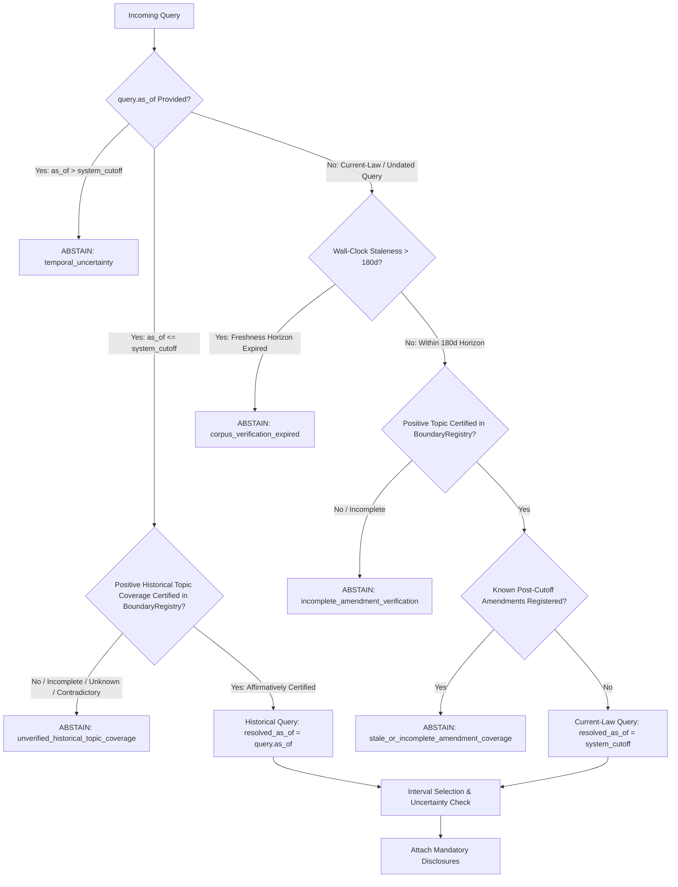

# Retrieval, Multi-Version Indexing & Verification Contracts

*Repo-grounded against `src/uae_lexagent/retrieval/contracts.py`, `src/uae_lexagent/retrieval/indexing.py`, `src/uae_lexagent/synthesis/contracts.py`, and `src/uae_lexagent/synthesis/verifier.py`.*

---

## 1. Fail-Closed `RetrievalFilters` Contract (`retrieval/contracts.py`)

```python
class RetrievalFilters(BaseModel):
    model_config = ConfigDict(extra="forbid", frozen=True)

    jurisdiction: Jurisdiction = Jurisdiction.UNKNOWN
    as_of: date | None = None
    language: Language = Language.UNKNOWN
    include_translations: bool = True
    authoritative_only: bool = False
    document_ids: tuple[str, ...] = ()
    legal_domain: str | None = None

    # Phase 5.2 fail-closed eligibility controls
    include_caveated: bool = False
    accepted_caveat_codes: tuple[str, ...] = ()
    allow_legacy_unverified: bool = False
    allow_stale_corpus: bool = False
```

### Eligibility Filter Rules (`matches_retrieval_filters`)
1. `BLOCKED_LEGAL_TOPIC` and `UNRESOLVED_HISTORICAL` ALWAYS return `False`.
2. `LEGACY_UNVERIFIED` returns `False` unless `filters.allow_legacy_unverified is True` (strictly confined to compatibility-test fixtures; prohibited in production).
3. `PUBLISHED_WITH_CAVEAT` returns `False` unless `filters.include_caveated is True` **AND** (either `filters.accepted_caveat_codes` is empty with downstream disclosure enforcement enabled, OR `set(provision.caveat_codes).issubset(set(filters.accepted_caveat_codes))`).
4. `VERIFIED_PUBLISHABLE` is eligible subject to jurisdiction, language, document, domain, and `as_of` filters.

---

## 2. Multi-Version `RetrievalIndex` Contract (`retrieval/indexing.py`)

### Index Maps
- `provisions_by_id: dict[str, LegalProvision]` — unique `provision_id`.
- `version_map: dict[str, dict[str, LegalProvision]]` — keyed by `version_id -> {lang: LegalProvision}`. Duplicate `(version_id, language)` raises `ValueError`.
- `versions_by_logical_id: dict[str, list[str]]` — maps `logical_provision_id -> list[version_id]` sorted by `effective_from`.
- `alignment_map: dict[str, dict[str, LegalProvision]]` — backward-compatible map populated with the single active (`IN_FORCE`) version per `alignment_id` (or the sole version in single-version legacy corpora).
- `quarantine_registry: dict[str, list[LegalProvision]]` — non-indexed metadata store for `UNRESOLVED_HISTORICAL` and `BLOCKED_LEGAL_TOPIC` provisions (never inserted into `vector_store` or `sparse_index`), used strictly to emit accurate abstention reasons.

### Same-Version Bilingual Alignment Invariant
- For any entry in `version_map[version_id]`: the Arabic provision (`ar_provision_id`) and English provision (`en_provision_id`) **MUST share the exact same `version_id`**.
- Cross-version alignment (e.g., pairing a 2024 Arabic amendment with a 2021 English provision) is strictly prohibited and rejected by `RV-09`.

### Candidate Version Pruning Before Rank Fusion
- In hybrid retrieval (dense + sparse BM25), multi-version candidate expansion occurs prior to scoring.
- For a given `as_of`, only the single active version per `logical_provision_id` is admitted into the candidate scoring pool. Inactive or superseded versions are pruned before reciprocal rank fusion to prevent score dilution or conflicting version citations in top-$k$ results.

---

## 3. Fail-Closed Current-Law & Temporal Safety Contract

To ensure that a historical corpus verification cutoff is **never silently presented as current law**, LexAgent enforces strict temporal disambiguation, positive coverage certification, freshness clocks, and multi-stage fail-closed gates.

### 3.1 Closed-World Assumption & Positive Coverage Requirement
- **Anti-Open-World Principle:** The absence of a registered subsequent amendment in `BoundaryRegistry` **must never be treated as evidence of complete statutory coverage**.
- An undated / current-law query may only be served if the queried topic/article is **positively certified** as having complete amendment coverage through the system verification cutoff date in `BoundaryRegistry.verified_topics`.
- **Incomplete / Unknown Registry Behavior:** If `BoundaryRegistry.coverage_status` is `UNKNOWN`, `INCOMPLETE`, or if the requested topic is not positively registered in `verified_topics`, the engine **MUST FAIL CLOSED** with `abstention_reason="incomplete_amendment_verification"`.

### 3.2 Precedence of Temporal & Freshness Checks

When evaluating a query, the system evaluates safety gates in the following strict order:



1. **Gate 1: Query Intent & Explicit Historical vs. Current-Law Resolution:**
   - **Explicit Historical Date (`query.as_of is not None`):**
     - If `query.as_of > system_cutoff`: **Fail closed immediately** with `abstention_reason="temporal_uncertainty"` (the system refuses to extrapolate future law).
     - If `query.as_of <= system_cutoff`:
       - **Gate 1B (Affirmative Historical Coverage Certification):** The queried statutory topic/article MUST be affirmatively certified in `BoundaryRegistry.verified_topics` as having complete, verified historical coverage spanning `query.as_of`.
       - *Strict Coverage Invariant:* Matching an existing historical provision version in the corpus is **strictly insufficient by itself**. If historical coverage for that topic at `query.as_of` is uncertified, missing, marked `UNKNOWN`, `INCOMPLETE`, or contradictory, the system **MUST FAIL CLOSED AND ABSTAIN** with `abstention_reason="unverified_historical_topic_coverage"`.
       - Only when positive historical coverage is certified does `resolved_as_of = query.as_of`. The answer is governed by historical status; system attaches `HISTORICAL_ANSWER_CAVEAT` and `TEMPORAL_CUTOFF_DISCLOSURE`. Explicit historical queries are exempt from the 180-day wall-clock execution limit, but remain strictly contingent upon verified historical topic coverage.
   - **Current-Law / Undated Query (`query.as_of is None`):**
     - The query seeks the current state of UAE employment law.
     - Must pass Gates 2, 3, and 4 before any substantive answer may be generated.

2. **Gate 2: 180-Day Freshness Horizon Clock (Execution Guardrail for Current Law):**
   - Let `system_cutoff = index.effective_as_of_max` (`2024-08-31`).
   - If `execution_date - system_cutoff > 180 days`:
     - The knowledge horizon of the corpus is stale relative to real-world time.
     - **Mandatory Invariant:** A warning alone **MUST NEVER** authorize a current-law answer. If the 180-day freshness horizon is expired, current-law queries **MUST FAIL CLOSED AND ABSTAIN** with:
       `abstention_reason="corpus_verification_expired"`.
     - *No bypass permitted:* Emitting substantive legal advice about "current law" when the knowledge horizon has expired violates legal safety, as subsequent unindexed amendments may have altered or repealed statutory obligations.

3. **Gate 3: Positive Topic Coverage & BoundaryRegistry Check (Current Law):**
   - The query's target topic/article must be positively listed in `BoundaryRegistry.verified_topics`.
   - If the topic is unlisted, marked `UNKNOWN`, or if `BoundaryRegistry.coverage_status != COMPLETE`, the system **MUST FAIL CLOSED AND ABSTAIN** with:
     `abstention_reason="incomplete_amendment_verification"`.

4. **Gate 4: Post-Cutoff Amendment Check:**
   - If candidate provisions belong to a topic with known post-cutoff amendments registered in `BoundaryRegistry.post_cutoff_amendments` (e.g. WPS rules under Ministerial Resolution 340/2026), the system **MUST FAIL CLOSED AND ABSTAIN** with:
     `abstention_reason="stale_or_incomplete_amendment_coverage"`.
   - Only when Gates 2, 3, and 4 pass does the current-law query bind to `resolved_as_of = system_cutoff` (`2024-08-31`) with mandatory `TEMPORAL_CUTOFF_DISCLOSURE`.

5. **Step 5: Closed Inclusive Interval Selection on `resolved_as_of`:**
   - For candidate `logical_provision_id`:
     - Check `quarantine_registry`: if an `UNRESOLVED_HISTORICAL` entry has `uncertainty_window_start <= resolved_as_of <= uncertainty_window_end`, abstain with `abstention_reason="temporal_uncertainty"`.
     - Check `quarantine_registry`: if matching version is `BLOCKED_LEGAL_TOPIC`, abstain with `abstention_reason="blocked_legal_topic"`.
     - Select eligible versions where `(effective_from is None or effective_from <= resolved_as_of)` AND `(effective_until is None or resolved_as_of <= effective_until)` AND `lifecycle_state in {IN_FORCE, SUPERSEDED}`.
     - Enforce cardinality: `count == 0` -> excluded; `count == 1` -> selected; `count > 1` -> fail closed with `abstention_reason="ambiguous_temporal_overlap"`.

6. **Step 6: Pending-Case Transitional Handling (FDL 9/2024 Art. 2 Operative Contract):**
   - For dispute procedure queries touching Article 54, the engine MUST execute the following mutually exclusive, strictly ordered decision logic:

     1. **Branch 1 (Coverage Requirement):** Require sufficient temporal and statutory coverage for Article 54 across its historical and current versions in `BoundaryRegistry.verified_topics`. If coverage is unlisted, `UNKNOWN`, or `INCOMPLETE`, fail closed with `abstention_reason="incomplete_amendment_verification"` (or `"unverified_historical_topic_coverage"` for explicit historical queries).
     2. **Branch 2 (Evaluation Date & Governing Version Resolution):** Resolve the evaluation date `resolved_as_of` (either from explicit `query.as_of` or bound to `system_cutoff = 2024-08-31` for current-law queries).
     3. **Branch 3 (Pre-Commencement Historical Evaluation):** If `resolved_as_of < 2024-08-31` (e.g., evaluated as of 2024-05-01):
        - Apply the statutory version governing that date (FDL 20/2023 version of Article 54: summary decisions <= AED 50,000 appealed to the Court of Appeal within 15 working days; court delivers judgment within 15 working days; 1-year limitation period).
        - Do **NOT** evaluate the FDL 9/2024 Article 2 transfer predicate.
        - Attach `HISTORICAL_ANSWER_CAVEAT` and `TEMPORAL_CUTOFF_DISCLOSURE`. Exit transition decision path.
     4. **Branch 4 (Substantive Scope Verification):** Check whether the matter arises under Article 54(3) of FDL 33/2021 as amended (a challenge/lawsuit by either party against a final summary decision issued by MoHRE under Article 54(2) for claims <= AED 50,000 or non-compliance with amicable settlements).
     5. **Branch 5 (Matters Outside Article 54(3) Scope):** If the matter falls outside Article 54(3):
        - Article 2 pending-case transfer does **NOT** apply.
        - **Explicit Exclusion of Article 54(4) Unresolved Referrals:** Article 54(4) disputes (unresolved labor complaints referred by MoHRE directly to the competent court for adjudication) are ordinary substantive referrals, NOT challenges to MoHRE summary decisions under Article 54(3); they are strictly excluded from Article 2 transfer scope.
        - The engine **MUST NOT** infer court jurisdiction or transfer from Article 2 for these matters; it must resolve them independently under ordinary procedural law or fail closed/abstain with `abstention_reason="missing_procedural_facts"`.
     6. **Branch 6 (Procedural Posture Evidence Sufficiency at Commencement):** For qualifying Article 54(3) matters evaluated at or after commencement (`resolved_as_of >= 2024-08-31`), determine procedural posture before the Court of Appeal (*محكمة الاستئناف*) as of the statutory commencement date (**31 August 2024**). Require affirmative evidence of: (a) pendency before the Court of Appeal as of 31 August 2024, (b) whether the lawsuit was already decided (*محكوم فيها*), and (c) whether the lawsuit was reserved for judgment (*محجوزة للحكم*).
     7. **Branch 7 (Missing or Contradictory Procedural Facts):** If required procedural facts (pendency at commencement, decided status, reserved-for-judgment status, or whether the dispute arises under Art. 54(3) vs Art. 54(4)) are missing, ambiguous, or contradictory:
        - The engine **MUST NEVER** infer transfer or court venue from filing date alone.
        - The engine **MUST FAIL CLOSED AND ABSTAIN** with `abstention_reason="missing_procedural_facts"` or prompt for necessary procedural facts.
     8. **Branch 8 (Decided Case Exception):** If the lawsuit was already decided (*محكوم فيها*) by the Court of Appeal prior to or as of 31 August 2024:
        - The statutory decision exception under Article 2 applies: **no transfer** to the Court of First Instance occurs; the matter remains under the authority of the Court of Appeal judgment.
     9. **Branch 9 (Reserved for Judgment Exception):** If the lawsuit was reserved for judgment (*محجوزة للحكم*) before the Court of Appeal as of 31 August 2024:
        - The statutory exception under Article 2 applies: **no transfer** occurs; jurisdiction remains with the Court of Appeal to render judgment.
     10. **Branch 10 (Qualifying Pending Lawsuit Transfer):** If the lawsuit arises under Article 54(3), was pending before the Court of Appeal on 31 August 2024, was **NOT** decided, and was **NOT** reserved for judgment:
         - Statutory transfer applies: the Court of Appeal transfers the lawsuit *ex officio* (*تحيل محاكم الاستئناف من تلقاء نفسها*) without judicial fees (*ودون رسوم*) to the competent Court of First Instance (*المحكمة الابتدائية المختصة*) in its existing condition (*بالحالة التي تكون عليها*).
         - Attach `PENDING_CASE_TRANSITION_DISCLOSURE`.
     11. **Branch 11 (Otherwise / Default Disposition):** For all other matters (including disputes instituted after 31 August 2024, which are filed directly before the Court of First Instance under Article 54(1) as amended by FDL 9/2024, or matters not pending at commencement):
         - Do **NOT** apply Article 2 transfer. Determine the applicable procedural rule separately under the post-commencement regime or abstain.

   - **Statutory Commencement Formula Invariant:** The authoritative commencement wording of FDL 9/2024 Article 4 (*يُعمل به بعد (30) ثلاثين يوماً من تاريخ نشره في الجريدة الرسمية*) is the primary legal foundation for the 31 August 2024 benchmark (Gazette No. 780 published 31 July 2024); the engine preserves the distinction between this statutory enactment formula and secondary publication evidence.

   - **Mandatory 8-Case Acceptance Matrix (Mutually Exclusive Outcomes):**
     Every dispute input maps deterministically to exactly one branch with zero possibility of simultaneously satisfying conflicting outcomes:
     - **Case 1 (S-11):** Qualifying Art. 54(3) challenge, pending at commencement, neither exception -> Branch 10 applies: Statutory transfer to Court of First Instance *ex officio* without judicial fees; `PENDING_CASE_TRANSITION_DISCLOSURE` attached.
     - **Case 2 (S-12):** Qualifying Art. 54(3) challenge, decided by Court of Appeal prior to/at commencement -> Branch 8 applies: Statutory exception applies; no transfer; Court of Appeal judgment stands.
     - **Case 3 (S-13):** Qualifying Art. 54(3) challenge, reserved for judgment before Court of Appeal at commencement -> Branch 9 applies: Statutory exception applies; no transfer; Court of Appeal retains jurisdiction to render judgment.
     - **Case 4 (S-14):** Article 54(4) unresolved referral (or other matter outside Art. 54(3)) -> Branch 5 applies: Article 2 transfer does not apply; resolve independently or abstain; never infer transfer from Article 2.
     - **Case 5 (S-15):** Historical evaluation date preceding commencement (`resolved_as_of < 2024-08-31`) -> Branch 3 applies: FDL 20/2023 version governs (Court of Appeal venue within 15 working days); transfer rule of Article 2 must not execute; `HISTORICAL_ANSWER_CAVEAT` attached.
     - **Case 6 (S-16):** Missing, ambiguous, or contradictory procedural facts (e.g. filing date provided without decided/reserved status, or unclear whether Art. 54(3) vs Art. 54(4)) -> Branch 7 applies: Engine refuses to infer court by filing date alone; fails closed with `abstention_reason="missing_procedural_facts"` or prompts for clarification.
     - **Case 7 (S-17):** Qualifying Art. 54(3) challenge instituted AFTER 31 August 2024 -> Branch 11 applies: No pending-case transfer (not pending at commencement); filed directly before competent Court of First Instance within 15 working days under FDL 9/2024 amended Art. 54(1).
     - **Case 8 (S-18):** Qualifying Art. 54(3) challenge instituted prior to commencement but dismissed, withdrawn, or otherwise not pending before Court of Appeal as of 31 August 2024 -> Branch 11 applies: No transfer under Article 2; ordinary procedural rules apply.

7. **Step 7: Mandatory Temporal Cutoff Disclosure:**
   - All undated answers MUST attach `TEMPORAL_CUTOFF_DISCLOSURE`:
     `"This answer is grounded exclusively in UAE federal employment legislation verified through 2024-08-31. Any statutory amendments, executive regulations, or ministerial decisions enacted after this date are not reflected."`
   - `CitationVerifier` enforces that this caveat is rendered in the final output text.

---

## 4. Multi-Stage Enforcement Architecture Across Actual Repository Modules

Temporal, boundary, and coverage validation is enforced across four discrete system checkpoints across actual repository modules:

1. **Pre-Retrieval Stage (`src/uae_lexagent/routing.py`, `src/uae_lexagent/agent/router.py`, `src/uae_lexagent/retrieval/contracts.py`):**
   - Validates jurisdiction boundaries, rejects DIFC/ADGM traps, checks the 180-day freshness horizon clock on current-law queries, checks `BoundaryRegistry` positive topic coverage (for current law and historical dates), and flags required procedural facts for Article 54 disputes.
2. **Statutory Tool Execution Stage (`src/uae_lexagent/tools.py`):**
   - Statutory calculation tools (e.g. `calculate_gratuity`, `evaluate_dispute_timeline`) validate `as_of` dates. If an input date exceeds `system_cutoff` or targets an unverified historical topic, tools fail closed with `temporal_uncertainty` rather than computing ungrounded results.
3. **Retrieval & Fusion Execution Stage (`src/uae_lexagent/retrieval/`):**
   - Enforced identically across standalone baseline retrieval (`src/uae_lexagent/retrieval/baseline.py`), vector store implementations (`src/uae_lexagent/retrieval/vector_store.py`: `InMemoryVectorStore.query()`, `QdrantVectorStore.query()`), sparse BM25 search (`src/uae_lexagent/retrieval/sparse.py`), hybrid fusion (`src/uae_lexagent/retrieval/hybrid.py`, `src/uae_lexagent/retrieval/fusion.py`), and multi-version index management (`src/uae_lexagent/retrieval/indexing.py`).
   - Candidate versions are pruned prior to Reciprocal Rank Fusion; same-version bilingual alignment collapsing is enforced.
4. **Synthesis & Verification Stage (`src/uae_lexagent/synthesis/engine.py`, `src/uae_lexagent/synthesis/verifier.py`):**
   - **Universal Evidence Provenance & Eligibility Gate:** Evidence passed to synthesis—whether received via the retrieval-driven entry point `LegalSynthesisEngine.synthesize(query)` or supplied directly to `LegalSynthesisEngine.synthesize_from_evidence(query, evidence)`—MUST pass the exact same provenance verification, publication-state check (`VERIFIED_PUBLISHABLE` by default, or `PUBLISHED_WITH_CAVEAT` with caller opt-in), and version-scoped claim authorization. Unverified caller evidence fails closed.
   - When filters are omitted by the caller (`filters=None`), strict system defaults apply (`include_caveated=False`, `allow_legacy_unverified=False`, `authoritative_only=False`). Caller evidence must NEVER bypass validation.
   - `CitationVerifier` verifies all cited `version_id`s against checksummed `data/official_sources/claim_key_registry.json`.
   - Verifies that all required caveat codes (e.g. `STATUTORY_INTERACTION_CR_96_2023`, `TEMPORAL_CUTOFF_DISCLOSURE`, `PENDING_CASE_TRANSITION_DISCLOSURE`, `HISTORICAL_ANSWER_CAVEAT`) are present in `GroundedLegalAnswer.caveat_disclosures` and rendered in `full_text`.
5. **Agent Orchestration & Publication Stage (`src/uae_lexagent/agent/nodes.py`, `src/uae_lexagent/agent/graph.py`, `src/uae_lexagent/agent/orchestrator.py`):**
   - `synthesis_node` executes direct generation via `LegalSynthesisEngine.synthesize_from_evidence()` using verified evidence and enforces that claim IDs derive exclusively from verified evidence.
   - Final response packaging in `src/uae_lexagent/agent/nodes.py` maps claim IDs to verified evidence IDs and guarantees full dual-path disclosure propagation: `LegalResponse.caveat_disclosures` mirrors `GroundedLegalAnswer.caveat_disclosures`, and `LegalResponse.citations` mirrors `GroundedLegalAnswer.citations`.
   - If an abstention was triggered at any stage, `retrieval_node`, `synthesis_node`, or `router_node` emits an uncompromised `LegalResponse` with `is_answered=False` and the exact `abstention_reason`.

---

### 4.1 Universal Evidence Invariants & Future Acceptance Scenarios

To ensure universal legal safety across all synthesis entry points, the following four invariants are mandated:
1. **Strict Default Fallbacks:** If `filters` are omitted or `None`, strict defaults apply (`include_caveated=False`, `allow_legacy_unverified=False`, `authoritative_only=False`).
2. **Universal Caller-Evidence Validation:** Caller-supplied evidence passed to `LegalSynthesisEngine.synthesize_from_evidence()` is subjected to the exact same provenance, publication state, and version-scoped checks as retrieved evidence; unverified caller evidence fails closed.
3. **Exclusive Verified Claim Derivation:** Claim IDs in `GroundedLegalAnswer` and `LegalResponse` must derive exclusively from authorized, verified `LegalProvision` and `version_id` records in `claim_key_registry.json`.
4. **Dual-Path Parity:** Version-scoped citations and caveat disclosures must be preserved identically across both `GroundedLegalAnswer` and `LegalResponse`.

#### Future Acceptance Scenarios (Implementation in M5.2.3 / M5.2.4):
- **Scenario 1 (Direct Caller Evidence Fails Closed on Strict Defaults):** Caller invokes `LegalSynthesisEngine.synthesize_from_evidence()` with `filters=None`. One or more supplied provisions have `publication_state=LEGACY_UNVERIFIED` or `PUBLISHED_WITH_CAVEAT`. Strict defaults reject the evidence; synthesis fails closed (`abstention_reason="unverified_evidence_provenance"` or `"unauthorized_caveated_evidence"`).
- **Scenario 2 (Direct Caller Evidence Succeeds with Verified Publishable Evidence):** Caller supplies clean `VERIFIED_PUBLISHABLE` provisions with approved claim keys in `claim_key_registry.json`. Provenance is verified; synthesis succeeds with verified citations.
- **Scenario 3 (Caller Passes Caveated Evidence with Explicit Opt-In):** Caller passes `PUBLISHED_WITH_CAVEAT` provisions (e.g. Article 51(2) with `STATUTORY_INTERACTION_CR_96_2023`) to `LegalSynthesisEngine.synthesize_from_evidence()` with `filters=RetrievalFilters(include_caveated=True)`. Engine validates caveat clearance; synthesis generates answer and attaches `STATUTORY_INTERACTION_CR_96_2023` to `caveat_disclosures`.
- **Scenario 4 (Retrieval-Driven Entry Point Enforces Candidate Pruning):** Caller invokes `LegalSynthesisEngine.synthesize(query)`. The engine executes retrieval via `retriever.search()` against `InMemoryVectorStore.query()` (or `QdrantVectorStore.query()`) and `BM25Index`, prunes candidates to the single active version per `logical_provision_id` under `query.as_of`, applies strict default filters, and delegates to `synthesize_from_evidence()`.
- **Scenario 5 (Agent Node Direct Generation & Claim-to-Evidence Derivation):** In `src/uae_lexagent/agent/nodes.py`, `synthesis_node` runs generation from state evidence and validates that every generated claim key derives exclusively from an approved evidence item in the verified evidence set.
- **Scenario 6 (Final Response Packaging Dual-Path Parity):** `src/uae_lexagent/agent/nodes.py` packages `GroundedLegalAnswer` into `LegalResponse`, preserving all version-scoped citations and caveat disclosures (`TEMPORAL_CUTOFF_DISCLOSURE`, `PENDING_CASE_TRANSITION_DISCLOSURE`, etc.) 1:1.
- **Scenario 7 (Fabricated Evidence Rejection):** Caller passes synthetic, unverified, or fabricated provision objects with spoofed IDs to `LegalSynthesisEngine.synthesize_from_evidence()` or `synthesis_node`. The universal gate fails closed as `VerificationStatus.UNVERIFIED` (`abstention_reason="unverified_evidence_provenance"`).

---

## 5. Fail-Closed `CitationVerifier` & Claim-Key Registry Contract (`src/uae_lexagent/synthesis/verifier.py`)

### Data-Driven Claim-Key Registry (`data/official_sources/claim_key_registry.json`)
- Replaces hardcoded `_ALIGNMENT_CLAIM_KEYS`.
- Loaded at `CitationVerifier` initialization with SHA-256 verification against `release_manifest.json`.
- Only entries with `review_status == "approved"` are active.
- **Zero Auto-Authorization:** Any `logical_provision_id` / `version_id` without an `approved` registry entry yields an empty allowed `claim_key` set -> every claim citing it fails closed as `VerificationStatus.UNVERIFIED` (`no_authorized_claim_keys`).
- **Version Scoping:** An entry applies ONLY if the retrieved evidence's `version_id` is in `entry.applicable_version_ids`. When an amendment creates a new `version_id` (e.g., Art. 54 `@2024-08-31`), prior claim keys do NOT carry over automatically.
- **Article 51 Invariant Binding:** Severance eligibility threshold claims (`gratuity_entitlement_service_threshold`) must bind to **Article 51(2)** (`FDL_33_2021_ART_51_02`), NOT Article 51(1).

---

## 6. Deterministic Regression Test Specifications

The following deterministic regression cases are specified for Phase 5.2 validation:

| Test ID | Test Scenario | Input Conditions | Expected Outcome | Enforcing Module |
|---|---|---|---|---|
| **REG-TEMPORAL-01** | Future Date Rejection | `as_of = 2026-01-01` (> `2024-08-31`) | Fail closed: `abstention_reason="temporal_uncertainty"` | `retrieval/contracts.py`, `retrieval/indexing.py` |
| **REG-TEMPORAL-02** | 180-Day Freshness Expiration (Current Law) | Wall-clock `now() > system_cutoff + 180d`, undated/current-law query | Fail closed: `abstention_reason="corpus_verification_expired"`; warning alone never authorizes current-law answer | `retrieval/indexing.py`, `agent/nodes.py` |
| **REG-TEMPORAL-03** | Verified Historical Query Past 180-Day Horizon | Wall-clock `now() > system_cutoff + 180d`, explicit historical query (`as_of = 2024-05-01` <= `system_cutoff`) with verified topic coverage | Query succeeds as retrospective answer; `HISTORICAL_ANSWER_CAVEAT` and `TEMPORAL_CUTOFF_DISCLOSURE` attached | `synthesis/verifier.py`, `agent/nodes.py` |
| **REG-TEMPORAL-04** | Provision Present but Historical Coverage Uncertified | Explicit historical query (`as_of = 2022-06-01`); matching provision exists in corpus, but topic coverage in `BoundaryRegistry` is uncertified (`UNKNOWN` or unlisted) | Fail closed: `abstention_reason="unverified_historical_topic_coverage"`; interval match alone is rejected | `retrieval/contracts.py`, `retrieval/hybrid.py` |
| **REG-TEMPORAL-05** | Positive Coverage Enforcement (Current Law) | Undated query on topic missing from `BoundaryRegistry.verified_topics` | Fail closed: `abstention_reason="incomplete_amendment_verification"` | `retrieval/contracts.py`, `agent/router.py` |
| **REG-TEMPORAL-06** | Stale Post-Cutoff Amendment | Undated query on topic in `BoundaryRegistry.post_cutoff_amendments` | Fail closed: `abstention_reason="stale_or_incomplete_amendment_coverage"` | `retrieval/contracts.py` |
| **REG-TEMPORAL-07** | Mandatory Cutoff Disclosure | Undated query on positively verified topic (Art. 54) | Output contains `TEMPORAL_CUTOFF_DISCLOSURE`; missing triggers verifier failure | `synthesis/verifier.py`, `agent/nodes.py` |
| **REG-TEMPORAL-08** | Historical Version Isolation | Query `as_of = 2024-03-15` for Article 54 | Retrieves FDL 20/2023 version (Court of Appeal); rejects 2024 version | `retrieval/indexing.py` |
| **REG-TRANSITION-01** | Qualifying Pending Lawsuit Transferred | Matter under Art. 54(3) pending before Court of Appeal on 31 Aug 2024, not decided, not reserved for judgment | Transferred *ex officio* to Court of First Instance without fees; `PENDING_CASE_TRANSITION_DISCLOSURE` attached | `synthesis/verifier.py`, `agent/nodes.py` |
| **REG-TRANSITION-02** | Decided Case Exception | Matter under Art. 54(3) where judgment was rendered by Court of Appeal prior to 31 Aug 2024 | Exception applies: decision remains under Court of Appeal; no transfer | `synthesis/verifier.py`, `agent/nodes.py` |
| **REG-TRANSITION-03** | Reserved-for-Judgment Case Exception | Matter under Art. 54(3) reserved for judgment before Court of Appeal on 31 Aug 2024 | Exception applies: remains before Court of Appeal to render judgment; no transfer | `synthesis/verifier.py`, `agent/nodes.py` |
| **REG-TRANSITION-04** | Art. 54(4) Unresolved Referral Inapplicability | Matter under Article 54(4) (unresolved dispute referred by MoHRE to court, rather than Art. 54(3) challenge) | Transition rule of Art. 2 does not apply; ordinary referral procedural rules apply; engine never infers transfer from Art. 2 | `retrieval/contracts.py`, `synthesis/verifier.py` |
| **REG-TRANSITION-05** | Historical Dispute Pre-Commencement | Dispute query evaluated as of `as_of = 2024-05-01` | Governed by FDL 20/2023: appealed to Court of Appeal within 15 working days; court decides within 15 working days | `retrieval/contracts.py`, `synthesis/verifier.py` |
| **REG-TRANSITION-06** | Ambiguous Procedural Facts Abstention | Case filed before Court of Appeal in June 2024, but procedural status (decided/reserved) is omitted | Engine refuses to infer court; fails closed with `abstention_reason="missing_procedural_facts"` or requests clarification | `agent/router.py`, `agent/nodes.py` |
| **REG-TRANSITION-07** | Post-Commencement Filing Venue | Qualifying Art. 54(3) dispute instituted after 31 Aug 2024 | Art. 2 pending-case transfer does not apply (not pending at commencement); filed directly before Court of First Instance within 15 working days under amended Art. 54(1) | `retrieval/contracts.py`, `agent/nodes.py` |
| **REG-TRANSITION-08** | Non-Pending Lawsuit at Commencement | Art. 54(3) challenge filed prior to 31 Aug 2024 but dismissed, withdrawn, or concluded before commencement | Art. 2 transfer does not apply; ordinary procedural rules apply | `retrieval/contracts.py`, `agent/nodes.py` |
| **REG-EVIDENCE-01** | Caller Evidence Strict Defaults | `LegalSynthesisEngine.synthesize_from_evidence()` called with `filters=None` and unverified/caveated evidence | Fails closed: strict defaults (`include_caveated=False`, `allow_legacy_unverified=False`) reject evidence | `synthesis/engine.py` |
| **REG-EVIDENCE-02** | Caller Evidence Provenance Verification | `LegalSynthesisEngine.synthesize_from_evidence()` called with verified publishable evidence and valid claim keys | Verifies cleanly; synthesizes `GroundedLegalAnswer` with verified citations | `synthesis/engine.py`, `synthesis/verifier.py` |
| **REG-EVIDENCE-03** | Caller Evidence Caveat Clearance | `LegalSynthesisEngine.synthesize_from_evidence()` called with caveated evidence and `include_caveated=True` | Succeeds with mandatory caveat disclosure attached to answer | `synthesis/engine.py`, `synthesis/verifier.py` |
| **REG-EVIDENCE-04** | Retrieval Entry-Point Candidate Pruning | `LegalSynthesisEngine.synthesize(query)` queries `InMemoryVectorStore.query()` / `BM25Index` | Candidates pruned to single active version per `logical_provision_id` before synthesis | `retrieval/vector_store.py`, `synthesis/engine.py` |
| **REG-EVIDENCE-05** | Agent Node Verified Claim Derivation | `synthesis_node` in `agent/nodes.py` generates claims from evidence | Claim IDs derive strictly from authorized provisions in `claim_key_registry.json`; fabricated IDs fail closed | `agent/nodes.py`, `synthesis/verifier.py` |
| **REG-EVIDENCE-06** | Response Packaging Dual-Path Parity | `agent/nodes.py` packages `GroundedLegalAnswer` into `LegalResponse` | All version-scoped citations and caveat disclosures mirrored 1:1 in `LegalResponse` | `agent/nodes.py` |
| **REG-EVIDENCE-07** | Fabricated Evidence ID Rejection | Caller passes fabricated provision IDs or unverified `version_id` to synthesis | Fails closed: `abstention_reason="unverified_evidence_provenance"` | `synthesis/engine.py`, `synthesis/verifier.py` |
| **REG-CLAIM-01** | Art 51 Clause Binding Invariant | Claim `gratuity_entitlement_service_threshold` citing Art 51(1) | Fails closed as `UNVERIFIED`: claim key not authorized for Art 51(1) | `synthesis/verifier.py` |
| **REG-CLAIM-02** | Art 51 Clause 2 Approval | Claim `gratuity_entitlement_service_threshold` citing Art 51(2) | Verifies cleanly; enforces `STATUTORY_INTERACTION_CR_96_2023` caveat | `synthesis/verifier.py` |
