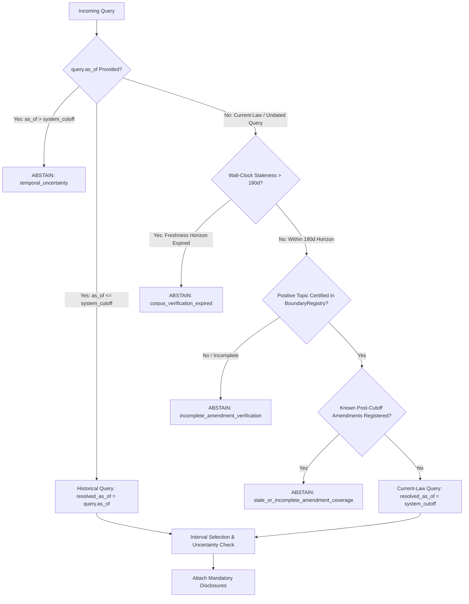

# Retrieval, Multi-Version Indexing & Verification Contracts

*Repo-grounded against `src/uae_lexagent/retrieval/contracts.py`, `src/uae_lexagent/retrieval/indexing.py`, `src/uae_lexagent/synthesis/contracts.py`, and `src/uae_lexagent/synthesis/verifier.py`.*

---

## 1. Fail-Closed `RetrievalFilters` Contract (`retrieval/contracts.py`)

```python
class RetrievalFilters(BaseModel):
    model_config = ConfigDict(extra="forbid", frozen=True)

    jurisdiction: Jurisdiction = Jurisdiction.UNKNOWN
    as_of: date | None = None
    language: Language = Language.UNKNOWN
    include_translations: bool = True
    authoritative_only: bool = False
    document_ids: tuple[str, ...] = ()
    legal_domain: str | None = None

    # Phase 5.2 fail-closed eligibility controls
    include_caveated: bool = False
    accepted_caveat_codes: tuple[str, ...] = ()
    allow_legacy_unverified: bool = False
    allow_stale_corpus: bool = False
```

### Eligibility Filter Rules (`matches_retrieval_filters`)
1. `BLOCKED_LEGAL_TOPIC` and `UNRESOLVED_HISTORICAL` ALWAYS return `False`.
2. `LEGACY_UNVERIFIED` returns `False` unless `filters.allow_legacy_unverified is True` (strictly confined to compatibility-test fixtures; prohibited in production).
3. `PUBLISHED_WITH_CAVEAT` returns `False` unless `filters.include_caveated is True` **AND** (either `filters.accepted_caveat_codes` is empty with downstream disclosure enforcement enabled, OR `set(provision.caveat_codes).issubset(set(filters.accepted_caveat_codes))`).
4. `VERIFIED_PUBLISHABLE` is eligible subject to jurisdiction, language, document, domain, and `as_of` filters.

---

## 2. Multi-Version `RetrievalIndex` Contract (`retrieval/indexing.py`)

### Index Maps
- `provisions_by_id: dict[str, LegalProvision]` — unique `provision_id`.
- `version_map: dict[str, dict[str, LegalProvision]]` — keyed by `version_id -> {lang: LegalProvision}`. Duplicate `(version_id, language)` raises `ValueError`.
- `versions_by_logical_id: dict[str, list[str]]` — maps `logical_provision_id -> list[version_id]` sorted by `effective_from`.
- `alignment_map: dict[str, dict[str, LegalProvision]]` — backward-compatible map populated with the single active (`IN_FORCE`) version per `alignment_id` (or the sole version in single-version legacy corpora).
- `quarantine_registry: dict[str, list[LegalProvision]]` — non-indexed metadata store for `UNRESOLVED_HISTORICAL` and `BLOCKED_LEGAL_TOPIC` provisions (never inserted into `vector_store` or `sparse_index`), used strictly to emit accurate abstention reasons.

### Same-Version Bilingual Alignment Invariant
- For any entry in `version_map[version_id]`: the Arabic provision (`ar_provision_id`) and English provision (`en_provision_id`) **MUST share the exact same `version_id`**.
- Cross-version alignment (e.g., pairing a 2024 Arabic amendment with a 2021 English provision) is strictly prohibited and rejected by `RV-09`.

### Candidate Version Pruning Before Rank Fusion
- In hybrid retrieval (dense + sparse BM25), multi-version candidate expansion occurs prior to scoring.
- For a given `as_of`, only the single active version per `logical_provision_id` is admitted into the candidate scoring pool. Inactive or superseded versions are pruned before reciprocal rank fusion to prevent score dilution or conflicting version citations in top-$k$ results.

---

## 3. Fail-Closed Current-Law & Temporal Safety Contract

To ensure that a historical corpus verification cutoff is **never silently presented as current law**, LexAgent enforces strict temporal disambiguation, positive coverage certification, freshness clocks, and multi-stage fail-closed gates.

### 3.1 Closed-World Assumption & Positive Coverage Requirement
- **Anti-Open-World Principle:** The absence of a registered subsequent amendment in `BoundaryRegistry` **must never be treated as evidence of complete statutory coverage**.
- An undated / current-law query may only be served if the queried topic/article is **positively certified** as having complete amendment coverage through the system verification cutoff date in `BoundaryRegistry.verified_topics`.
- **Incomplete / Unknown Registry Behavior:** If `BoundaryRegistry.coverage_status` is `UNKNOWN`, `INCOMPLETE`, or if the requested topic is not positively registered in `verified_topics`, the engine **MUST FAIL CLOSED** with `abstention_reason="incomplete_amendment_verification"`.

### 3.2 Precedence of Temporal & Freshness Checks

When evaluating a query, the system evaluates safety gates in the following strict order:



1. **Gate 1: Query Intent & Explicit Historical vs. Current-Law Resolution:**
   - **Explicit Historical Date (`query.as_of is not None`):**
     - If `query.as_of > system_cutoff`: **Fail closed immediately** with `abstention_reason="temporal_uncertainty"` (the system refuses to extrapolate future law).
     - If `query.as_of <= system_cutoff`: `resolved_as_of = query.as_of`. The answer is governed by historical status; system attaches `HISTORICAL_ANSWER_CAVEAT` and `TEMPORAL_CUTOFF_DISCLOSURE`.
   - **Current-Law / Undated Query (`query.as_of is None`):**
     - The query seeks the current state of UAE employment law.
     - Must pass Gates 2, 3, and 4 before any substantive answer may be generated.

2. **Gate 2: 180-Day Freshness Horizon Clock (Execution Guardrail for Current Law):**
   - Let `system_cutoff = index.effective_as_of_max` (`2024-08-31`).
   - If `execution_date - system_cutoff > 180 days`:
     - The knowledge horizon of the corpus is stale relative to real-world time.
     - **Mandatory Invariant:** A warning alone **MUST NEVER** authorize a current-law answer. If the 180-day freshness horizon is expired, current-law queries **MUST FAIL CLOSED AND ABSTAIN** with:
       `abstention_reason="corpus_verification_expired"`.
     - *No bypass permitted:* Emitting substantive legal advice about "current law" when the knowledge horizon has expired violates legal safety, as subsequent unindexed amendments may have altered or repealed statutory obligations.

3. **Gate 3: Positive Topic Coverage & BoundaryRegistry Check:**
   - The query's target topic/article must be positively listed in `BoundaryRegistry.verified_topics`.
   - If the topic is unlisted, marked `UNKNOWN`, or if `BoundaryRegistry.coverage_status != COMPLETE`, the system **MUST FAIL CLOSED AND ABSTAIN** with:
     `abstention_reason="incomplete_amendment_verification"`.

4. **Gate 4: Post-Cutoff Amendment Check:**
   - If candidate provisions belong to a topic with known post-cutoff amendments registered in `BoundaryRegistry.post_cutoff_amendments` (e.g. WPS rules under Ministerial Resolution 340/2026), the system **MUST FAIL CLOSED AND ABSTAIN** with:
     `abstention_reason="stale_or_incomplete_amendment_coverage"`.
   - Only when Gates 2, 3, and 4 pass does the current-law query bind to `resolved_as_of = system_cutoff` (`2024-08-31`) with mandatory `TEMPORAL_CUTOFF_DISCLOSURE`.

5. **Step 5: Closed Inclusive Interval Selection on `resolved_as_of`:**
   - For candidate `logical_provision_id`:
     - Check `quarantine_registry`: if an `UNRESOLVED_HISTORICAL` entry has `uncertainty_window_start <= resolved_as_of <= uncertainty_window_end`, abstain with `abstention_reason="temporal_uncertainty"`.
     - Check `quarantine_registry`: if matching version is `BLOCKED_LEGAL_TOPIC`, abstain with `abstention_reason="blocked_legal_topic"`.
     - Select eligible versions where `(effective_from is None or effective_from <= resolved_as_of)` AND `(effective_until is None or resolved_as_of <= effective_until)` AND `lifecycle_state in {IN_FORCE, SUPERSEDED}`.
     - Enforce cardinality: `count == 0` -> excluded; `count == 1` -> selected; `count > 1` -> fail closed with `abstention_reason="ambiguous_temporal_overlap"`.

6. **Step 6: Pending-Case Transitional Handling (FDL 9/2024 Art. 2):**
   - For dispute procedure queries touching Article 54 where the underlying dispute was instituted prior to 31 August 2024:
     - The engine MUST evaluate the transitional rule: lawsuits and applications filed before the Court of Appeal prior to 31 August 2024 are transferred without judicial fees to the Court of First Instance.
     - **Mandatory Transition Exception:** If a judgment was already rendered or the lawsuit was reserved for judgment (*المحكوم فيها أو المحجوزة للحكم*), the lawsuit remains before the Court of Appeal.
     - The system attaches `PENDING_CASE_TRANSITION_DISCLOSURE` to the response disclosures.

7. **Step 7: Mandatory Temporal Cutoff Disclosure:**
   - All undated answers MUST attach `TEMPORAL_CUTOFF_DISCLOSURE`:
     `"This answer is grounded exclusively in UAE federal employment legislation verified through 2024-08-31. Any statutory amendments, executive regulations, or ministerial decisions enacted after this date are not reflected."`
   - `CitationVerifier` enforces that this caveat is rendered in the final output text.

---

## 4. Multi-Stage Enforcement Architecture

Temporal and coverage validation is enforced across four distinct system checkpoints:

1. **Pre-Retrieval Stage (`RetrievalFilters` & Query Validator):**
   - Validates jurisdiction boundaries, rejects DIFC/ADGM traps, checks the 180-day freshness horizon clock, and checks `BoundaryRegistry` positive topic coverage.
2. **Statutory Tool Execution Stage (`tools.py`):**
   - Statutory calculation tools (e.g. `calculate_gratuity`, `evaluate_dispute_timeline`) validate `as_of` dates. If an input date exceeds `system_cutoff`, tools fail closed or return `temporal_uncertainty` rather than computing ungrounded results.
3. **Synthesis & Verification Stage (`CitationVerifier`):**
   - Verifies all cited `version_id`s against `claim_key_registry.json`.
   - Ensures that all required caveat codes (e.g. `STATUTORY_INTERACTION_CR_96_2023`, `TEMPORAL_CUTOFF_DISCLOSURE`, `PENDING_CASE_TRANSITION_DISCLOSURE`) are present in `GroundedLegalAnswer.caveat_disclosures` and visibly rendered in `full_text`.
4. **Agent Orchestration & Publication Stage (`graph.py` / `LegalResponse`):**
   - Guarantees full disclosure propagation from `GroundedLegalAnswer` to `LegalResponse`.
   - `LegalResponse.caveat_disclosures` mirrors `GroundedLegalAnswer.caveat_disclosures`.
   - If an abstention was triggered at any stage, the agent emits an uncompromised `LegalResponse` with `is_answered=False` and the exact `abstention_reason`.

---

## 5. Fail-Closed `CitationVerifier` & Claim-Key Registry Contract (`synthesis/verifier.py`)

### Data-Driven Claim-Key Registry (`data/official_sources/claim_key_registry.json`)
- Replaces hardcoded `_ALIGNMENT_CLAIM_KEYS`.
- Loaded at `CitationVerifier` initialization with SHA-256 verification against `release_manifest.json`.
- Only entries with `review_status == "approved"` are active.
- **Zero Auto-Authorization:** Any `logical_provision_id` / `version_id` without an `approved` registry entry yields an empty allowed `claim_key` set -> every claim citing it fails closed as `VerificationStatus.UNVERIFIED` (`no_authorized_claim_keys`).
- **Version Scoping:** An entry applies ONLY if the retrieved evidence's `version_id` is in `entry.applicable_version_ids`. When an amendment creates a new `version_id` (e.g., Art. 54 `@2024-08-31`), prior claim keys do NOT carry over automatically.
- **Article 51 Invariant Binding:** Severance eligibility threshold claims (`gratuity_entitlement_service_threshold`) must bind to **Article 51(2)** (`FDL_33_2021_ART_51_02`), NOT Article 51(1).

---

## 6. Deterministic Regression Test Specifications

The following deterministic regression cases are specified for Phase 5.2 validation:

| Test ID | Test Scenario | Input Conditions | Expected Outcome | Enforcing Module |
|---|---|---|---|---|
| **REG-TEMPORAL-01** | Future Date Rejection | `as_of = 2026-01-01` (> `2024-08-31`) | Fail closed: `abstention_reason="temporal_uncertainty"` | `RetrievalFilters`, `Indexing` |
| **REG-TEMPORAL-02** | 180-Day Freshness Expiration (Current Law) | Wall-clock `now() > system_cutoff + 180d`, undated/current-law query | Fail closed: `abstention_reason="corpus_verification_expired"`; warning alone never authorizes current-law answer | `RetrievalIndex`, `Agent` |
| **REG-TEMPORAL-03** | Historical Query Past 180-Day Horizon | Wall-clock `now() > system_cutoff + 180d`, explicit historical query (`as_of = 2024-05-01` <= `system_cutoff`) | Query succeeds as retrospective answer; `HISTORICAL_ANSWER_CAVEAT` and `TEMPORAL_CUTOFF_DISCLOSURE` attached | `CitationVerifier`, `LegalResponse` |
| **REG-TEMPORAL-04** | Positive Coverage Enforcement | Undated query on topic missing from `BoundaryRegistry.verified_topics` | Fail closed: `abstention_reason="incomplete_amendment_verification"` | `RetrievalFilters` |
| **REG-TEMPORAL-05** | Stale Post-Cutoff Amendment | Undated query on topic in `BoundaryRegistry.post_cutoff_amendments` | Fail closed: `abstention_reason="stale_or_incomplete_amendment_coverage"` | `RetrievalFilters` |
| **REG-TEMPORAL-06** | Mandatory Cutoff Disclosure | Undated query on positively verified topic (Art. 54) | Output contains `TEMPORAL_CUTOFF_DISCLOSURE`; missing triggers verifier failure | `CitationVerifier`, `LegalResponse` |
| **REG-TEMPORAL-07** | Historical Version Isolation | Query `as_of = 2024-03-15` for Article 54 | Retrieves FDL 20/2023 version (Court of Appeal); rejects 2024 version | `RetrievalIndex` |
| **REG-TRANSITION-01** | Pending-Case Transition Advice | Dispute query with filing date `2024-05-01` | Explains referral to Court of First Instance without fees; notes exception for decided matters | `CitationVerifier`, `LegalResponse` |
| **REG-TRANSITION-02** | Decided Case Exception | Dispute query where judgment was rendered prior to 2024-08-31 | Identifies exception: case remains before Court of Appeal | `CitationVerifier`, `LegalResponse` |
| **REG-CLAIM-01** | Art 51 Clause Binding Invariant | Claim `gratuity_entitlement_service_threshold` citing Art 51(1) | Fails closed as `UNVERIFIED`: claim key not authorized for Art 51(1) | `CitationVerifier` |
| **REG-CLAIM-02** | Art 51 Clause 2 Approval | Claim `gratuity_entitlement_service_threshold` citing Art 51(2) | Verifies cleanly; enforces `STATUTORY_INTERACTION_CR_96_2023` caveat | `CitationVerifier` |
